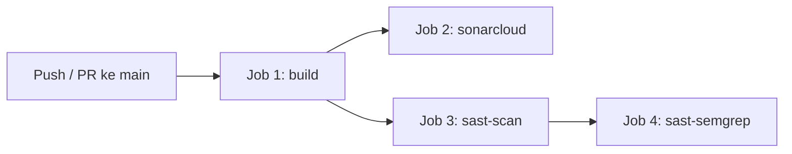
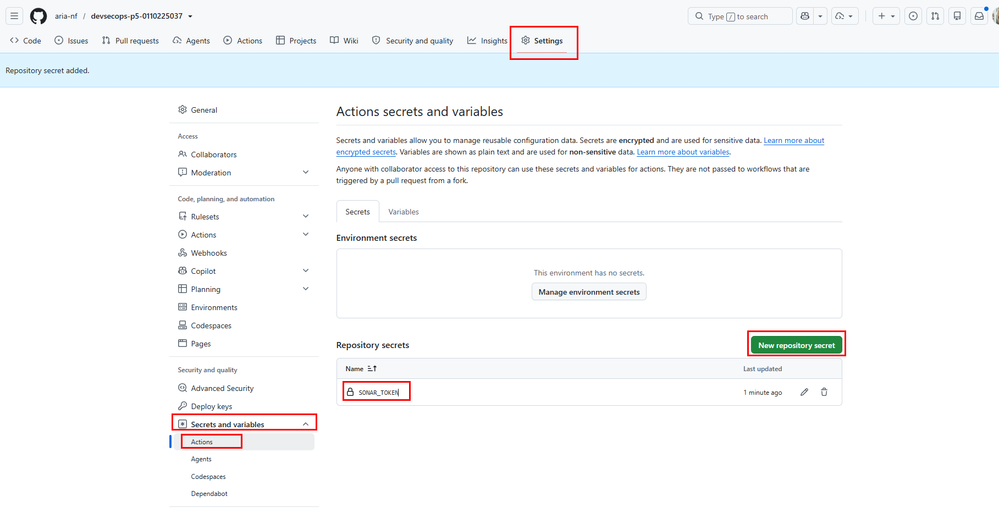
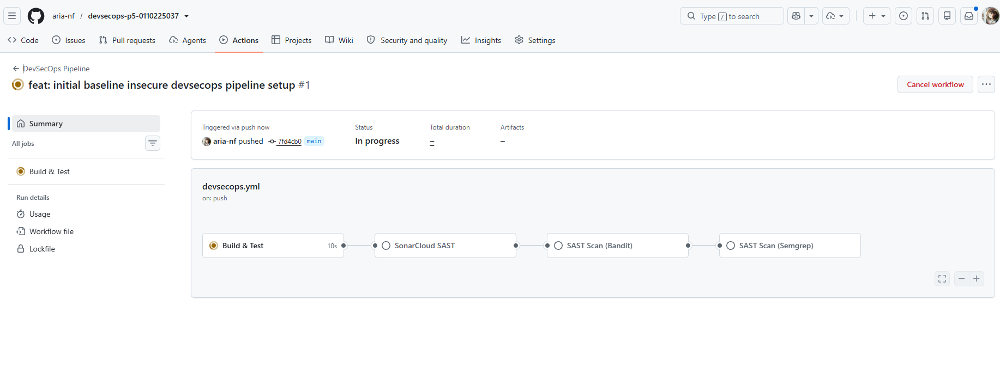
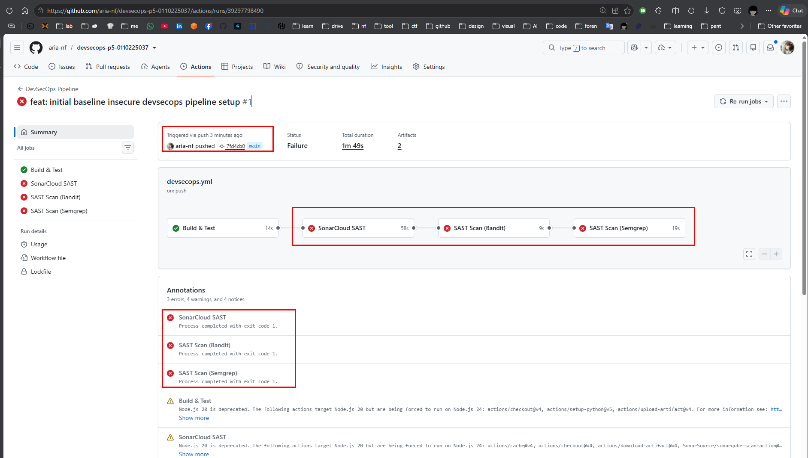
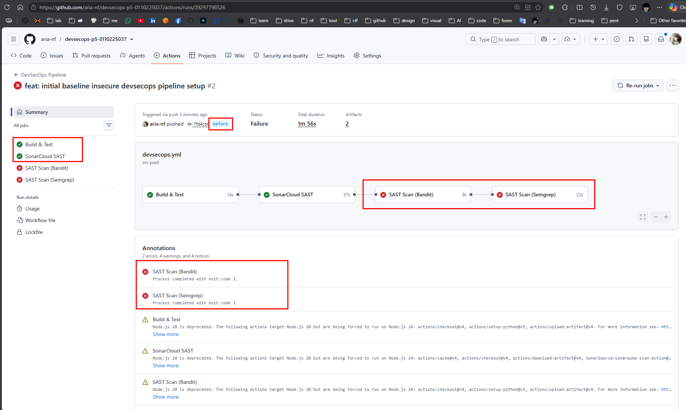
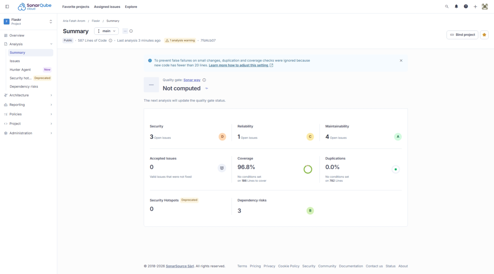
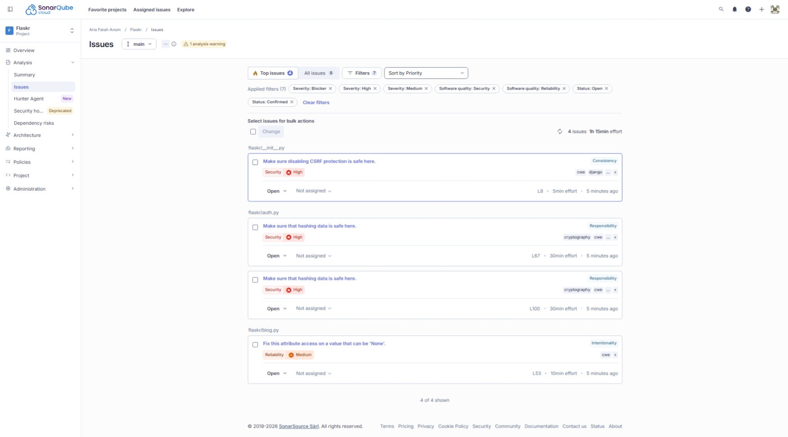
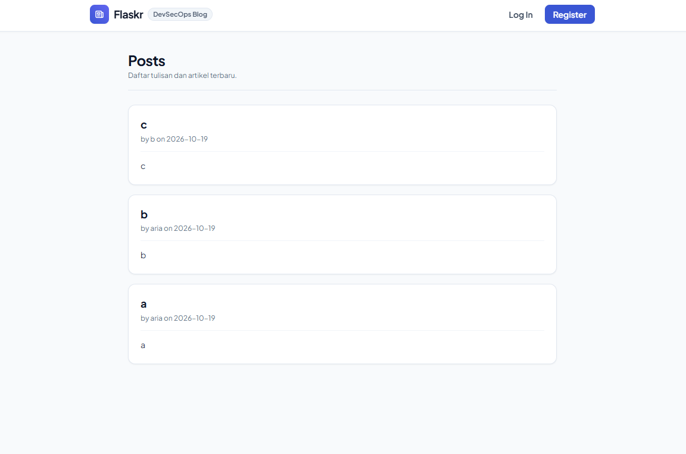

# Flaskr — DevSecOps Pipeline Lab

[](https://github.com/aria-nf/devsecops-p5-0110225037/actions/workflows/devsecops.yml)
[](https://sonarcloud.io/summary/new_code?id=aria-nf_flaskr)
[](https://sonarcloud.io/summary/new_code?id=aria-nf_flaskr)
[](https://sonarcloud.io/summary/new_code?id=aria-nf_flaskr)

---

## 1. Nama Aplikasi & Fungsinya

**Flaskr** adalah aplikasi web blog sederhana yang memungkinkan pengguna untuk registrasi akun, login, serta membuat, mengedit, dan menghapus postingan blog (CRUD). Aplikasi ini digunakan sebagai studi kasus implementasi pipeline **DevSecOps** dengan pendekatan *Shift-Left Security*.

## 2. Bahasa & Framework

| Komponen | Teknologi |
| :--- | :--- |
| Bahasa Pemrograman | Python 3.11 |
| Web Framework | Flask 3.x |
| Frontend Styling | Tailwind CSS |
| Database | SQLite (built-in) |
| Testing | Pytest + Coverage |
| SAST Tools | SonarCloud, Bandit, Semgrep |

### Struktur Source Code

```text
flaskr/
├── __init__.py        # Application factory & konfigurasi
├── auth.py            # Blueprint autentikasi (register, login, logout)
├── blog.py            # Blueprint blog CRUD (create, update, delete)
├── db.py              # Koneksi & inisialisasi database SQLite
├── schema.sql         # DDL schema tabel user & post
├── templates/         # Jinja2 HTML templates
└── static/            # CSS & static assets
tests/
├── conftest.py        # Pytest fixtures & test client
├── test_factory.py    # Test application factory
├── test_db.py         # Test database connection
├── test_auth.py       # Test autentikasi (register, login, logout)
└── test_blog.py       # Test CRUD blog
wsgi.py                # Entry point server
Dockerfile             # Container image
```

## 3. Cara Menjalankan Aplikasi

**Prasyarat:** Python 3.10+ dan Git.

```bash
# 1. Clone repository
git clone https://github.com/aria-nf/devsecops-p5-0110225037.git
cd devsecops-p5-0110225037

# 2. Buat virtual environment & aktivasi
python -m venv .venv
source .venv/bin/activate        # Linux/macOS
# .\.venv\Scripts\Activate.ps1   # Windows PowerShell

# 3. Install dependencies
pip install -r requirements.txt

# 4. Inisialisasi database
flask --app flaskr init-db

# 5. Jalankan server
python wsgi.py
```

Akses di browser: **http://127.0.0.1:5000**

## 4. Overview Pipeline CI/CD

Pipeline didefinisikan di [`.github/workflows/devsecops.yml`](.github/workflows/devsecops.yml) dan terpicu otomatis pada **push ke branch `main`** dan **pull_request ke branch `main`**.

### Diagram Alur Pipeline



### Deskripsi Job

| Job | Runner | Depends On | Fungsi |
| :--- | :--- | :--- | :--- |
| **`build`** | `ubuntu-latest` | — | Install dependencies, jalankan unit test Pytest dengan coverage gate ≥ 80% |
| **`sonarcloud`** | `ubuntu-latest` | `build` | SonarCloud SAST scan + Quality Gate check |
| **`sast-scan`** | `ubuntu-latest` | `build` | Bandit SAST scanner — gagalkan pipeline jika ada temuan Medium/High severity |
| **`sast-semgrep`** | `ubuntu-latest` | `build`, `sast-scan` | Semgrep semantic scan dengan ruleset OWASP Top 10 |

### Quality Gates yang Diterapkan

1. **Coverage Gate** — Pytest `--cov-fail-under=80` (pipeline gagal jika coverage < 80%)
2. **SonarCloud Quality Gate** — Gagal jika Security Rating di bawah A atau ada blocker issue
3. **Bandit Gate** — `bandit -ll` memblokir pipeline pada temuan Medium/High
4. **Semgrep Gate** — `semgrep --error` memblokir pipeline pada pelanggaran rule

---

## Struktur Branch

Repositori memiliki 2 branch untuk demonstrasi:

- **`main`** — Kode yang sudah diremediasi. Seluruh job pipeline **PASSED ✅**.
- **`before`** — Kode baseline dengan kerentanan keamanan dan issues yang terdeteksi scanner (SQL Injection, Risky MD5 Hashing, Hardcoded Secret, Production Debug Mode, serta bug & code smells SonarCloud). Pipeline **FAILED ❌** pada job SAST & Quality Gate.

| Gate | Branch `before` | Branch `main` |
| :--- | :---: | :---: |
| Pytest Coverage | ✅ Passed | ✅ Passed (100%) |
| SonarCloud | ❌ Failed | ✅ Passed (Rating A) |
| Bandit | ❌ Failed | ✅ Passed (0 Issues) |
| Semgrep | ❌ Failed | ✅ Passed (0 Issues) |

---

### Lampiran









